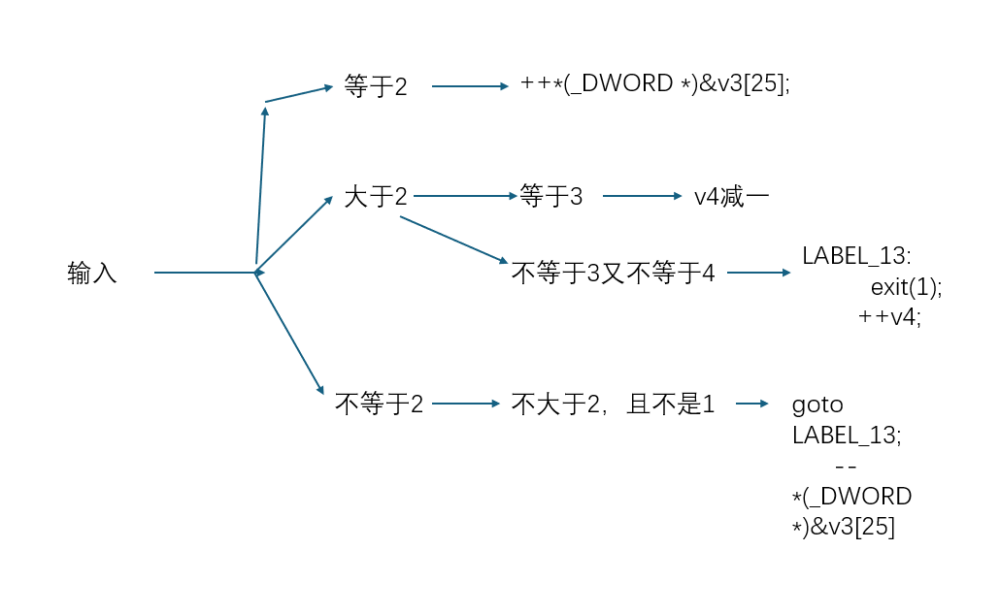

知道这是一道迷宫图之后，来吧他的判断条件具体到迷宫怎么走上



看最后的判断公式能看出很多线索：

```
   if ( v7[5 * *(_DWORD *)&v3[25] - 41 + v4] == 49 )
      exit(1);
    if ( v7[5 * *(_DWORD *)&v3[25] - 41 + v4] == 35 )
    {
      puts("\nok, the order you enter is the flag!");
      exit(0);
}
```

等于1时退出，等于#时成功

V3[25]算是y轴，因为乘五了，所以也可以推断出一行有五个，而v4算是x轴，程序把x,y的信息存放在这两个变量里

所以已经可以把这个地图画出来

```
1 1 1 1
0 1 0 0 0
0 1 0 1 0
0 0 0 1 0
1 1 1 1 #
```

所以可以根据这个地图得到flag了。

222441144222
