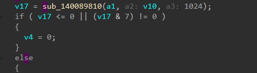
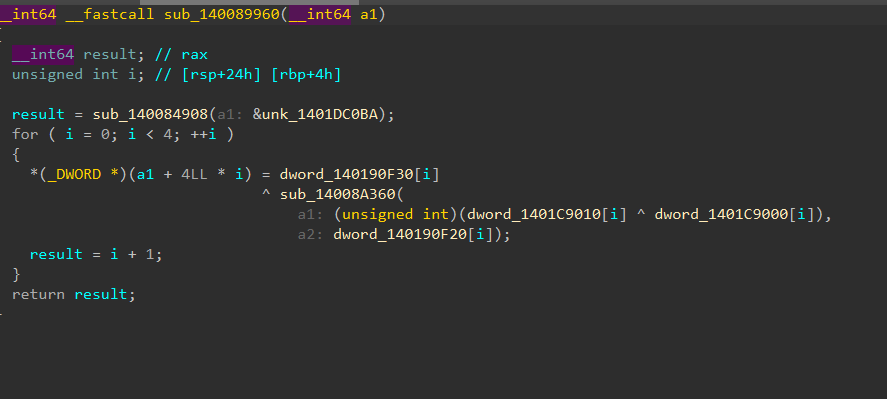
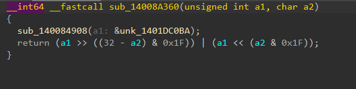
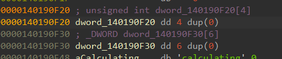
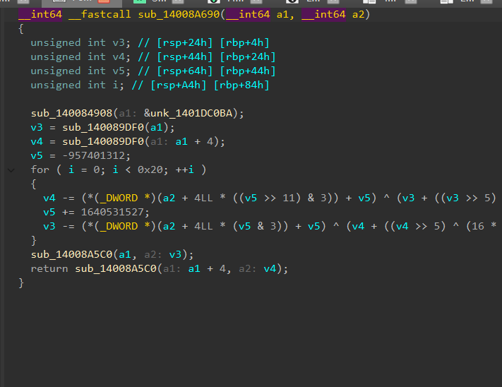
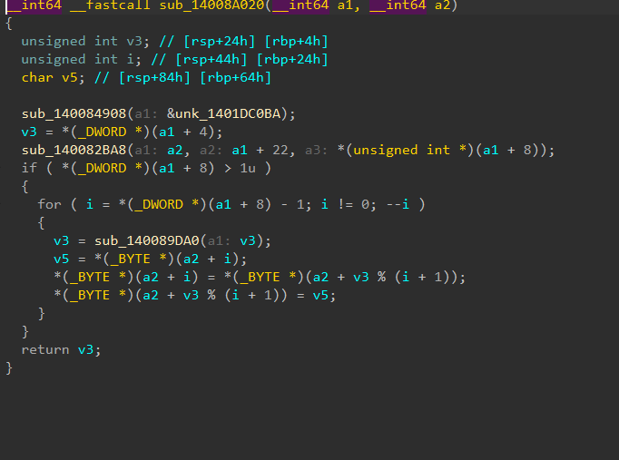

根据nc 10.110.0.43 57982的反馈搜的字符串capsule，能找到相关的代码

解胶囊



```
sub_140089810 返回字节数
```



密钥生成

公式大概是key=dword_140190F30[i]^ sub_14008A360（(unsigned int)(dword_1401C9010[i] ^ dword_1401C9000[i]),

```
                                  a2: dword_140190F20[i]）
```



```
(x, n) = (x << (n & 31)) | (x >> ((32 - n) & 31))
```



大概是这样而俩表都是0



这个是解密hex用的，用来得到seed，这段接受之前结出来的key和capsule的hex，解成明文，把他抄下来照着就能得出seed啊，五个人的牌，剩下的42张

两个数组一会得到key的

把给出的字符抄出来做个异或能得到key

```
key[0] = 0xA56BABCD
key[1] = 0x13579BDF
key[2] = 0xC0DEC0DE
key[3] = 0x9E3779B9
```

然后是解密CAPSULE hex

用的是xtea解密hex，主要是得到种子，

哪刚刚拿到的key，解出来xtea算法，把尾巴去掉，只要得到种子就好了，顺道有了底牌，和其他的42张牌

```python
import struct
import sys

k = (0xA56BABCD, 0x13579BDF, 0xC0DEC0DE, 0x9E3779B9)
R = "23456789TJQKA"
S = "CDHS"

def dec(blk):
    v0, v1 = struct.unpack("<2I", blk)
    t = 0xC6EF3720
    for _ in range(32):
        v1 = (v1 - ((((v0 << 4) ^ (v0 >> 5)) + v0) ^ (t + k[(t >> 11) & 3]))) & 0xFFFFFFFF
        t = (t - 0x9E3779B9) & 0xFFFFFFFF
        v0 = (v0 - ((((v1 << 4) ^ (v1 >> 5)) + v1) ^ (t + k[t & 3]))) & 0xFFFFFFFF
    return struct.pack("<2I", v0, v1)

def unp(h):
    e = bytes.fromhex(h)
    p = b"".join(dec(e[i:i+8]) for i in range(0, len(e), 8))
    p = p[:-p[-1]]
    _, _, s, pl = struct.unpack("<4sIII", p[:16])
    holes = [list(p[16+i*2:18+i*2]) for i in range(5)]
    pool = list(p[26:26+pl])
    return s, holes, pool

hx = sys.argv[1]
s, holes, pool = unp(hx)
print("seed:", hex(s))
for i, h in enumerate(holes):
    print(i, "".join(R[c%13]+S[c//13] for c in h))
print("pool:", len(pool))
```



洗牌，他接受我们之前解出来的和牌堆

```
v3 = *(_DWORD *)(a1 + 4);就是拿种子初始化
sub_140082BA8(a2, a1 + 22, *(unsigned int *)(a1 + 8));
```

牌堆的复制

```
*(_DWORD *)(a1 + 8) > 1u
```

有判断pool_len > 1的时候洗牌，从种子一步步往前捯，一共41次

```
v5 = *(_BYTE *)(a2 + i);
*(_BYTE *)(a2 + i) = *(_BYTE *)(a2 + v3 % (i + 1));
*(_BYTE *)(a2 + v3 % (i + 1)) = v5;
```

交换

洗牌是LCG，把42个牌面洗成真正的发牌顺序

他的lcg有了种子就能抄下来然后一步步往前推，倒退出牌面

得到一个真正的牌堆

```python
import struct
import sys

k = (0xA56BABCD, 0x13579BDF, 0xC0DEC0DE, 0x9E3779B9)
R = "23456789TJQKA"
S = "CDHS"

def dec(blk):
    v0, v1 = struct.unpack("<2I", blk)
    t = 0xC6EF3720
    for _ in range(32):
        v1 = (v1 - ((((v0 << 4) ^ (v0 >> 5)) + v0) ^ (t + k[(t >> 11) & 3]))) & 0xFFFFFFFF
        t = (t - 0x9E3779B9) & 0xFFFFFFFF
        v0 = (v0 - ((((v1 << 4) ^ (v1 >> 5)) + v1) ^ (t + k[t & 3]))) & 0xFFFFFFFF
    return struct.pack("<2I", v0, v1)

def unp(h):
    e = bytes.fromhex(h)
    p = b"".join(dec(e[i:i+8]) for i in range(0, len(e), 8))
    p = p[:-p[-1]]
    _, _, s, pl = struct.unpack("<4sIII", p[:16])
    return s, list(p[26:26+pl])

def shuf(seed, pool):
    st = seed
    d = list(pool)
    for i in range(len(d)-1, 0, -1):
        st = (st * 1664525 + 1013904223) & 0xFFFFFFFF
        j = st % (i+1)
        d[i], d[j] = d[j], d[i]
    return d

hx = sys.argv[1]
s, p = unp(hx)
d = shuf(s, p)
print("".join(R[c%13]+S[c//13] for c in d))
```

发牌是给定群切牌数，丢掉切的，烧一下，给三张，烧一下，给一张，烧一下给一张，算出公共牌。

因为只可能是4种切牌数量，算一下就行

```python
import struct
import sys

k = (0xA56BABCD, 0x13579BDF, 0xC0DEC0DE, 0x9E3779B9)
R = "23456789TJQKA"
S = "CDHS"

def dec(blk):
    v0, v1 = struct.unpack("<2I", blk)
    t = 0xC6EF3720
    for _ in range(32):
        v1 = (v1 - ((((v0 << 4) ^ (v0 >> 5)) + v0) ^ (t + k[(t >> 11) & 3]))) & 0xFFFFFFFF
        t = (t - 0x9E3779B9) & 0xFFFFFFFF
        v0 = (v0 - ((((v1 << 4) ^ (v1 >> 5)) + v1) ^ (t + k[t & 3]))) & 0xFFFFFFFF
    return struct.pack("<2I", v0, v1)

def unp(h):
    e = bytes.fromhex(h)
    p = b"".join(dec(e[i:i+8]) for i in range(0, len(e), 8))
    p = p[:-p[-1]]
    _, _, s, pl = struct.unpack("<4sIII", p[:16])
    return s, list(p[26:26+pl])

def shuf(seed, pool):
    st = seed
    d = list(pool)
    for i in range(len(d)-1, 0, -1):
        st = (st * 1664525 + 1013904223) & 0xFFFFFFFF
        j = st % (i+1)
        d[i], d[j] = d[j], d[i]
    return d

hx = sys.argv[1]
s, p = unp(hx)
d = shuf(s, p)
for cut in range(4):
    pos = cut + 1
    b = d[pos:pos+3]
    pos += 4
    b.append(d[pos])
    pos += 2
    b.append(d[pos])
print("CUT", cut, ":", "".join(R[c%13]+S[c//13] for c in b))
```

之后根据德州扑克规则利用得到的牌面来跟ai赌就好
