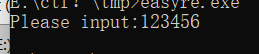
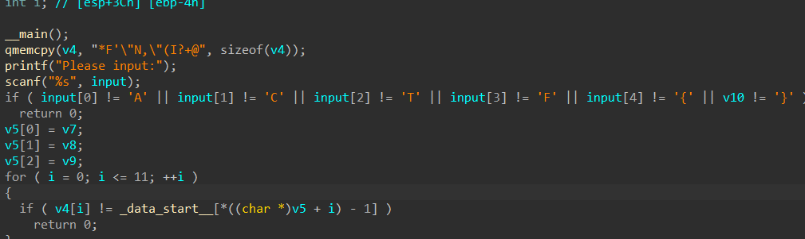
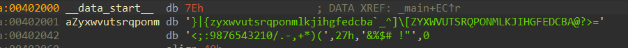

得到一个tar文件，拿7z解压后得到了一个exe文件，运行之后让我们输入内容

放到ida里什么也没有，用upx查壳发现有壳，脱壳后再放入ida里有了线索



吸取了之前的教训，看声明之后的提示，我知道从input[0]到v10都是输入的内容，上面的判断内容给出了我们外壳，然后把内里存进v5之后，进行了如下判断

_data_start_[V5的每一项减一]是否等于v4的第i项。



我们双击能够找到_data_start_

所以要得到v5，我们需要找到v4对应的datastart的项数，加一减i

```python
data_start = '~}|{zyxwvutsrqponmlkjihgfedcba`_^]\\[ZYXWVUTSRQPONMLKJIHGFEDCBA@?>=<;:9876543210/.-,+*)(\x27&%$# !"'
v4 = "*F'\"N,\"(I?+@"

flag = ''
for c in v4:
    idx = data_start.find(c)
    flag += chr(idx + 1)

print('ACTF{' + flag + '}')
```
