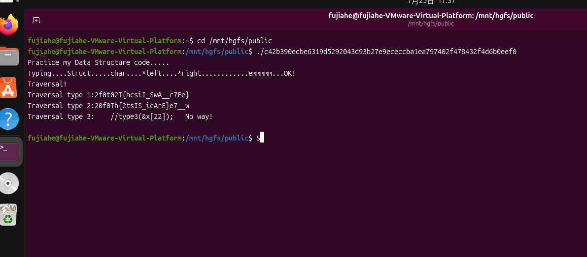
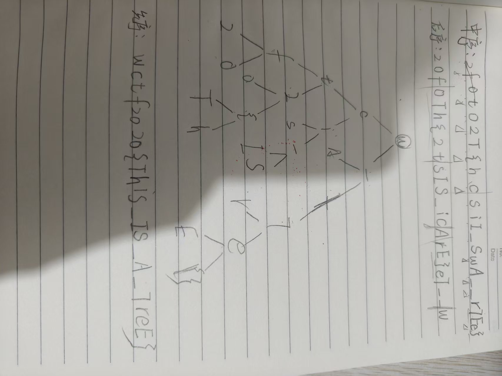
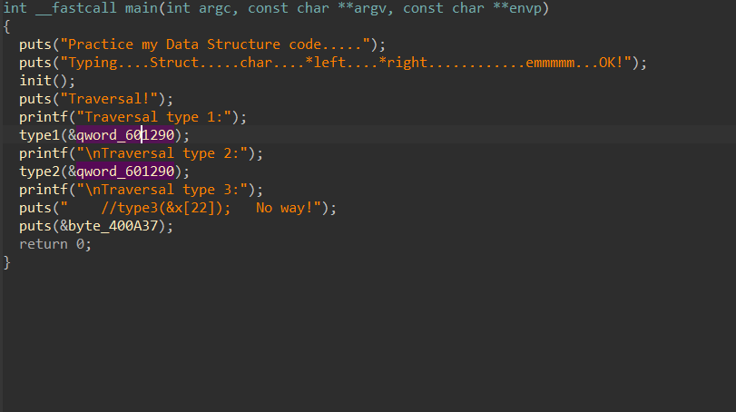
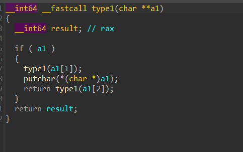
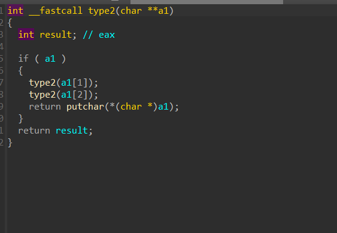

.ELF文件，无壳

运行之后给了我一些莫名其妙的字符串，看不懂，有点像乱的flag

在ida里main函数是这样的，那两个很像flag的字符串是从type1和type2里面出来的

这两个函数的递归我一开始向量很久但是还是看不懂他是想干什么，到网上查发现是二叉树，我找教程学了学二叉树，输出在递归之中，type1是中序，输出在递归之后，type2是后序，所以我们还原二叉树，然后用前序得到flag

