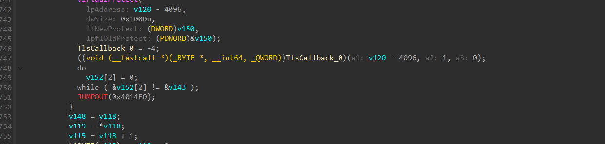
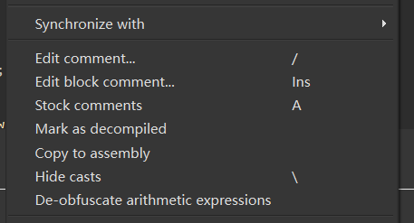
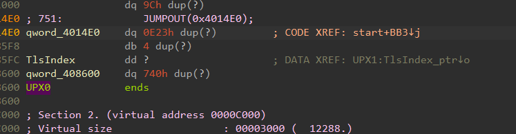
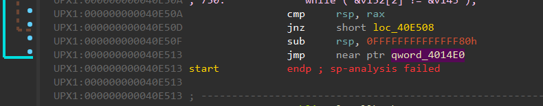
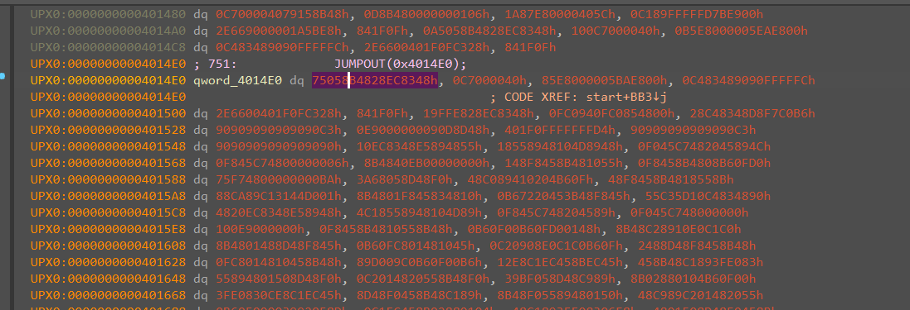
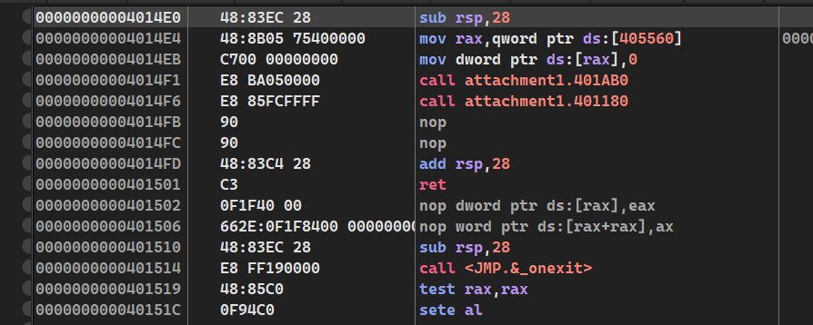

现在我已经彻底掌握手脱upx了，这里展示其中一个，放进ida里看，这个题很明显，只要查看f5就可以找到oep，jumpout是一个明显的信号！

Copy过去

找调用它的地方就好了，因为我们是要在跳转过来的地方断一下来判断一下

果然是有一个大跳转！，那就没找错，在这里下一个断点运行一下看一下，记住刚刚4014E0的地方的样子

我们下好断点调过来看一下，原本空的地方有数据了。那就对了，我们在x64看一下，在这个数据的地方等着，运行运行，等壳跑完。

那就简单了，用Scylla dump掉就好。这是其中一个办法。
