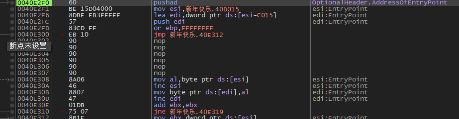
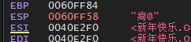
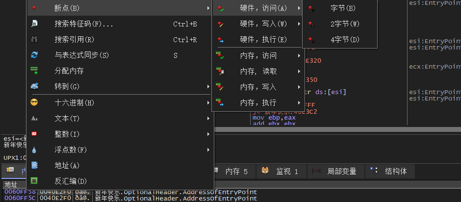
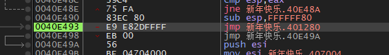
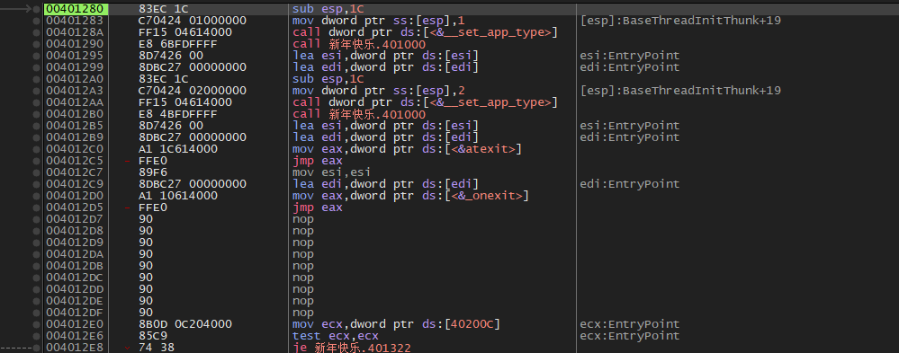

现在我已经彻底掌握手脱upx了，这里展示另一个！也就是esp的方法，找pushad的方法，原理就是利用它保存寄存器之后一定要把数据pop出来的，在x32时候比较好用，因为pushad很明显！

往下运行一步，就被存入栈之中

把它复制，在内存窗口下上硬件断点，

F9运行之后它命中了，但是在一个循环里，f4跳出来就好

这个大跳转跳过去就能看出来，我们找到oep了，后面dump一下就好了

