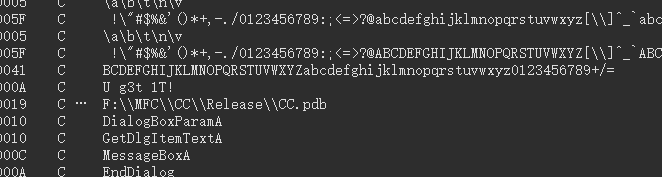
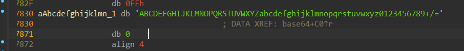
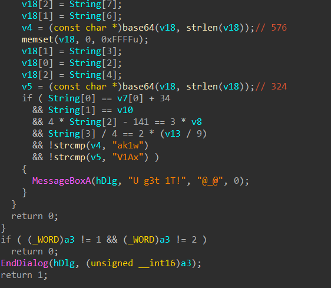
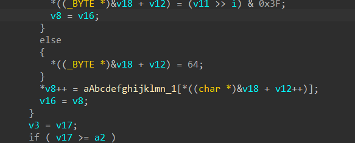
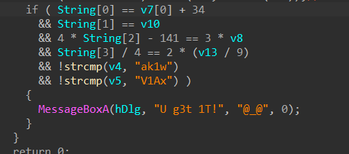
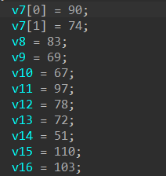
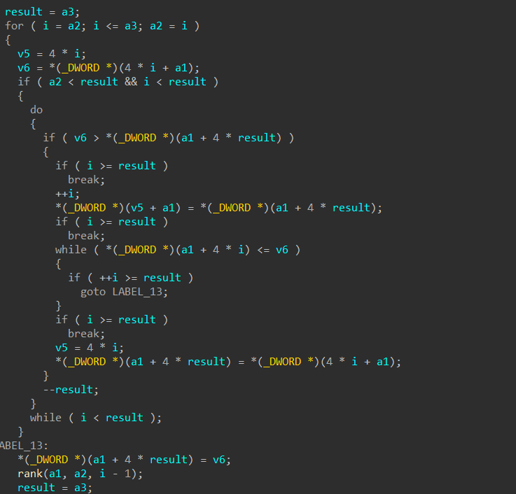
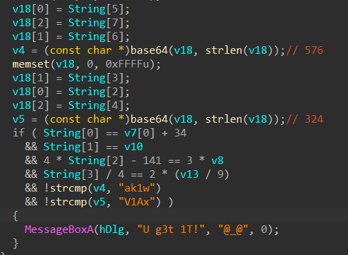

运行程序之后是一个刮开有奖的界面，没有别的内容，我们在ida里搜索到了这样的几个线索：

Bcd。。。。。。最后是+/=，怀疑是base64，不过少了一个a，双击进去就可以看见其实是没缺的，摁a就可以看见

U g3t 1T，应该是得到flag的证明，交叉引用找到主要的函数

我们找到了在哪里运用了base64，看见这里有运用标准表

做好标注之后来观察主要的函数

可以看到要想输出U g3t 1T字符串，就要满足以上的条件，上面已经有了一串的初始化了

所以可以先进行运算

String是依靠这些初始化来进行的，他们经历了一个函数，是一个排序

从小到大地把这些初始化进行排序过后，把部分的string进行了base64

最后按照判断的条件倒回去进行解码就可以得到flag
