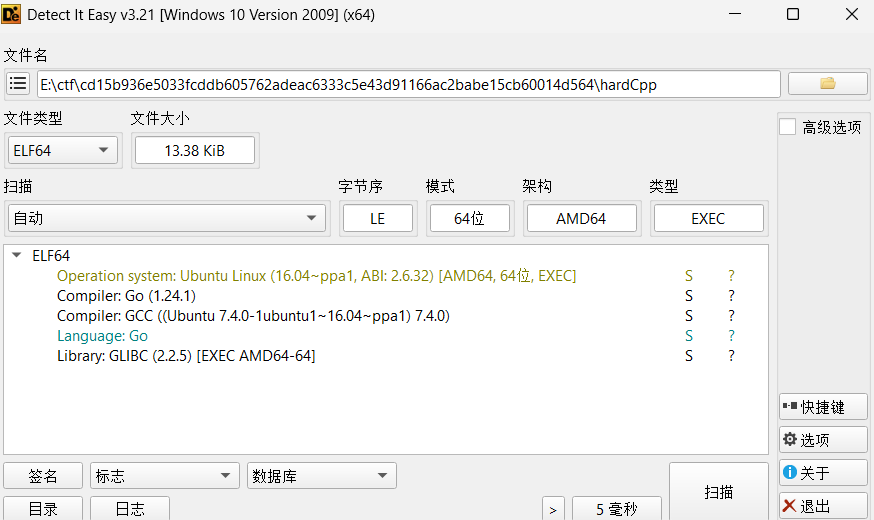
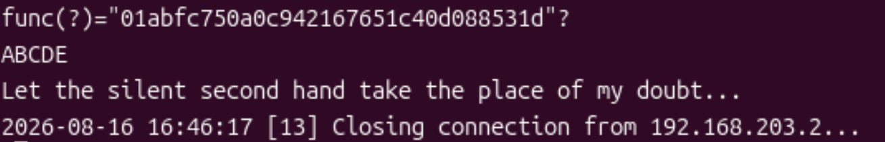
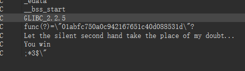
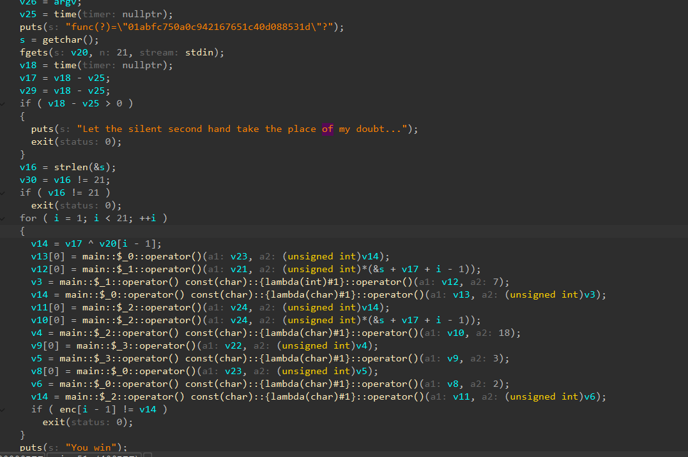
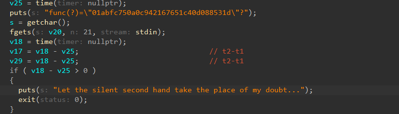
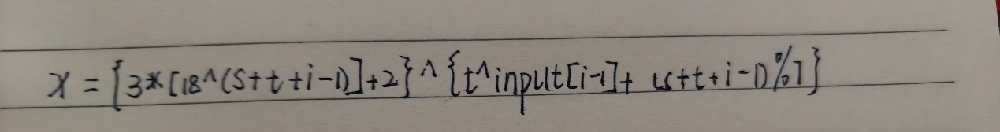
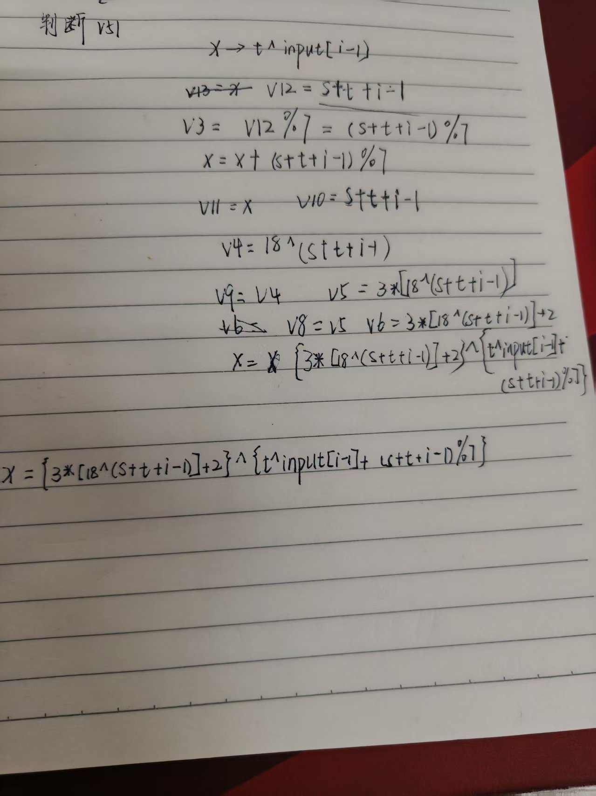

无壳，ELF文件



放进虚拟机运行是这样的





字符串里面有一些线索

用d810插件之后变成了简单的函数









因为v18-v25>0就要退出，而v25在前，v18在后，所以肯定是会大于0的，所以肯定会退出，不过现在可以直接看，

推导出来公式是enc[i-1] = ( ( ( (S + t + i - 1) ^ 18 ) * 3 ) + 2 ) ^ ( ( t ^ input[i-1] ) + ( (S + t + i - 1) % 7 ) )

t=0就忽略掉，然后s是有&的，也就是地址，把我们输入的内容当初flag字符串，哪就变成了

```
for(int i=0; i<20; i++)
enc[i] = (((flag[i]^18)*3+2)) ^ (flag[i+1] + (flag[i]%7));
```

把这个等式反过来看，把 flag[i+1] 单独拎出来（等式右边只有它是未知的，enc 和 flag[i] 都是已知）：

```
flag[i+1] = (enc[i] ^ (((flag[i] ^ 18) * 3 + 2))) - flag[i] % 7
```

只要我知道 flag[i]，我就能算出 flag[i+1]。 而 enc[i] 已知。

所以它是一根链条：

知道 flag[0] → 算出 flag[1]

知道 flag[1] → 算出 flag[2]

知道 flag[2] → 算出 flag[3]

……一直推到 flag[20]

但是我想了很久也没想出来怎么去解决，用了ai，总体的思路是一个函数进行递推后面来一个筛选：1.必须在ASCII码内2.含有flag3必须是能打印

```python
# ===== SUCTF2019 hardcpp 求解 =====
# 从 hardCpp.c 反编译得出的关系（t=0 后）：
#   enc[i] = (((flag[i]^18)*3+2)) ^ (flag[i+1] + flag[i]%7)
# 推出：
#   flag[i+1] = (enc[i] ^ (((flag[i]^18)*3+2))) - flag[i]%7

# 第1步：已知的 enc 数组（20个字节）
enc = [0xF3, 0x2E, 0x18, 0x36, 0xE1, 0x4C, 0x22, 0xD1, 0xF9, 0x8C,
       0x40, 0x76, 0xF4, 0x0E, 0x00, 0x05, 0xA3, 0x90, 0x0E, 0xA5]

# 第2步：给定开头 first，按公式推出整条 flag
def make_candidate(first):
    flag = bytearray(21)
    flag[0] = first                            # 开头（第一个字符）
    for i in range(0, 20):                     # enc 有 20 个，i 从 0 到 19
        # 用公式推出下一个字符 flag[i+1]
        flag[i+1] = (enc[i] ^ (((flag[i] ^ 18) * 3) + 2)) - (flag[i] % 7)
        flag[i+1] &= 0xFF                      # 只保留低8位（字节必须 0~255）
    return flag

# 第3步：检查整条是否全可打印
def is_printable(flag):
    for c in flag:
        if not (0x20 <= c <= 0x7e):
            return False
    return True

# 第5步：检查形状是否为 #flag{...}
def looks_like_flag(flag):
    s = flag.decode(errors='replace')
    return s.startswith('#flag{') and s.endswith('}')

# 第4步：枚举所有可能的首字符
for first in range(0x20, 0x7f):
    candidate = make_candidate(first)
    if is_printable(candidate) and looks_like_flag(candidate):
        print("flag:", candidate.decode())
```
