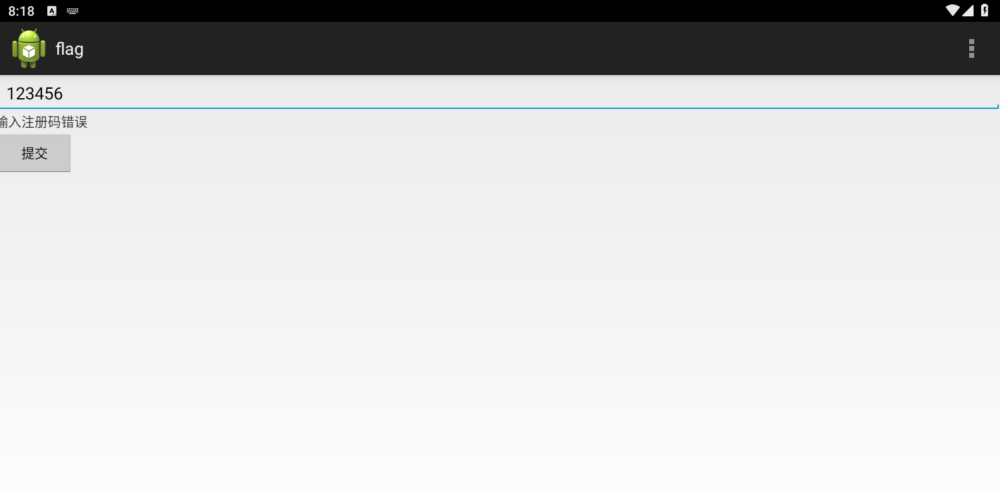
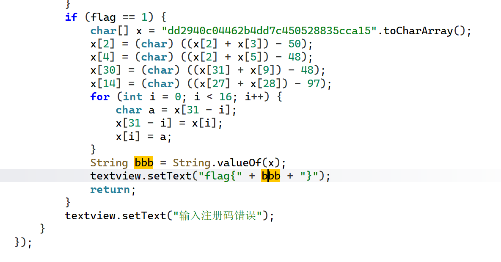

解压得到的apk文件运行之后让我们输入内容判断正误

我搜索了输入注册码错误的字符串，找到了主要的函数，



我从bbb往上追溯，这个代码的逻辑应该是给了x一段字符串，然后进行了一些变换之后，再经过循环把顺序倒过来，就是bbb了，只要得到了经过上面两个过程之后的bbb就能得到flag，按照他的代码跑一下就可以了

```python
x = list("dd2940c04462b4dd7c450528835cca15")
x[2] = chr((ord(x[2]) + ord(x[3])) - 50)
x[4] = chr((ord(x[2]) + ord(x[5])) - 48)
x[30] = chr((ord(x[31]) + ord(x[9])) - 48)
x[14] = chr((ord(x[27]) + ord(x[28])) - 97)
for i in range(16):
    x[i], x[31 - i] = x[31 - i], x[i]
bbb = ''.join(x)
print("flag{" + bbb + "}")
```

得到答案
