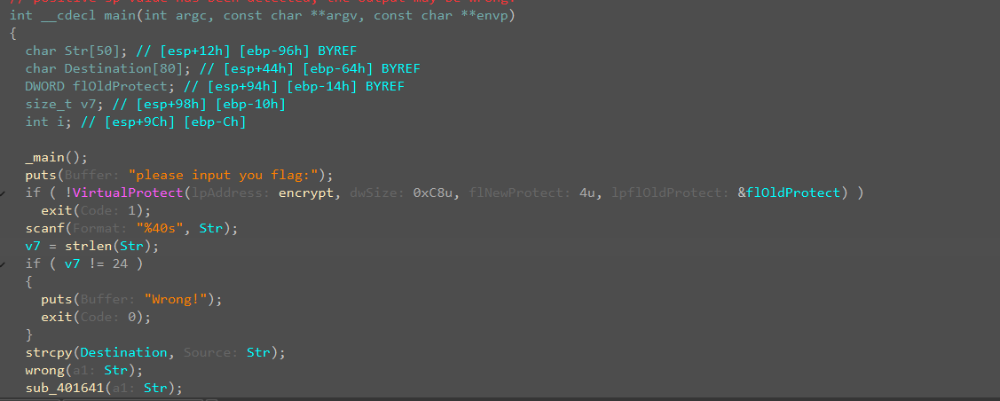
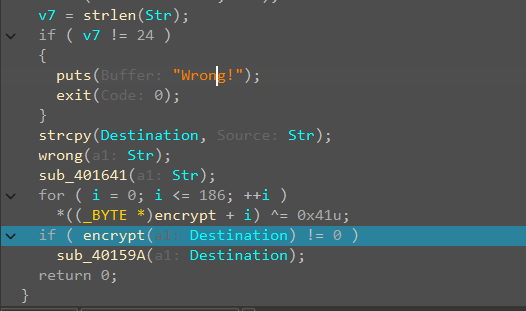
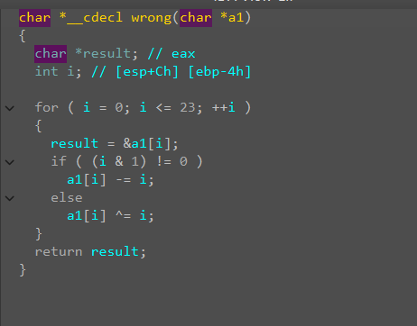
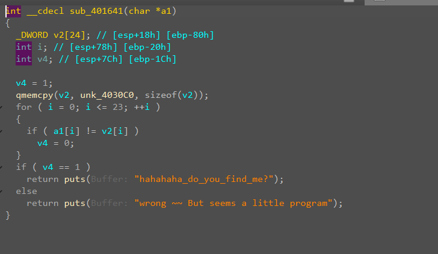
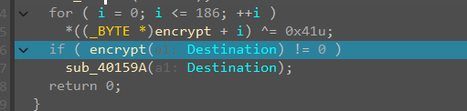
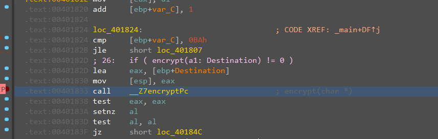
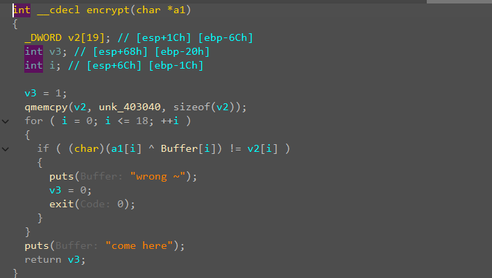
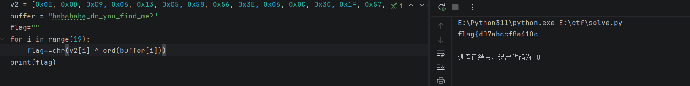
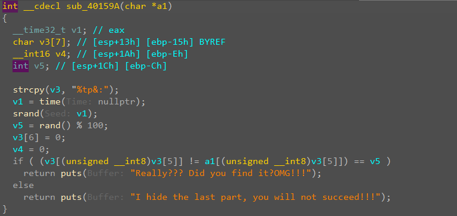
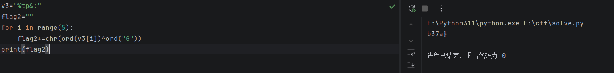

**搜字符串能搜到输入**

**能看到他使用了VirtualProtect，说明是个smc，他改变了权限。**

后面的逻辑很清晰，输入一个24长度的东西，不符合就退出来，然后还要字符串，之后执行两个函数，一个wrong，一个sub_401641

这个函数是输入的内容进行变换

&是按位与，(i & 1) != 0可以用来判断奇偶

**1 & 1 = 1**

**1 & 0 = 0**

**0 & 1 = 0**

**0 & 0 = 0**

如果最低位是 1，结果为 1（非零），条件成立 → i 是奇数。

如果最低位是 0，结果为 0，条件不成立 → i 是偶数。

所以这个地方是奇数的，-=i，是偶数的，^=i.

就是给str变换了一下。

进行一个判断，与unk_4030C0里的内容进行对比，错误输出错误，正确输出hahaha，但是并没有结束，这个flag交上去含义是一个滚木，假的。

主要是看下面的

这就是smc在解密，在调用的时候断下来，看下面的判断，如果不对的话就结束，正确的话进入sub_40159A，否则就是结束，所以在这里断一下，运行一下之后，就解密完成了，然后，进去取消定义转成代码，然后变成函数，就能f5看到encrypt

这个里面才是真正的答案。他传入的是复制的，原始的输入，而不是变换过的str。

这里是确定了前面的18个，就拿到半拉。

但是要求我们输入24个，剩下的

这个什么函数感觉没啥意义，还是靠运气的而且我没找到跟后面半拉有啥关系。我剩下那一半咋来啊

最后肯定是}，哪个什么v3刚好5个：肯定和哪个}对应着，但是还是不知道到底怎么弄的，我没招了去搜了wp，他们都特么猜的，说猜的异或，试了一下异或发现其实还挺像那么回事的。

最后确实能得到。
