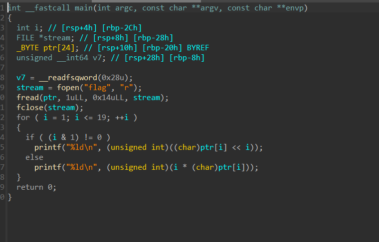

放到ida里找到主函数观察代码



查资料知道**v7 =__readfsqword(0x28u);**

是一个栈保护，先略过

后面打开了一个flag文件，然后赋值给了ptr，之后经历一个循环，用(i & 1) != 0判断了奇偶，然后如果是奇数则把当前位左移i位，如果是偶数就进行相乘。

所以我们先得到ptr，他给我们了一个output.txt就是我们要用的输出，反过来的逻辑就是，把i是奇数的时候的项右移i位，i是偶数的时候项是除i

```cpp
#include <iostream>
#include <vector>
using namespace std;

int main() {
    vector<long long> out = {
        198,232,816,200,1536,300,6144,984,
        51200,570,92160,1200,565248,756,1474560,
        800,6291456,1782,65536000
    };
    for (int i = 1; i <= 19; ++i) {
        char ch;
        if (i & 1)
            ch = out[i-1] >> i;
        else
            ch = out[i-1] / i;
        cout << ch;
    }
    cout << endl;
    return 0;
}
```
