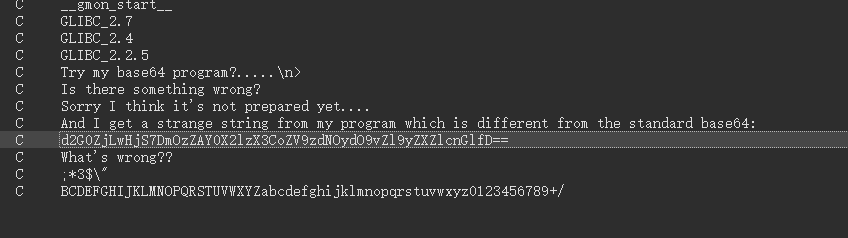
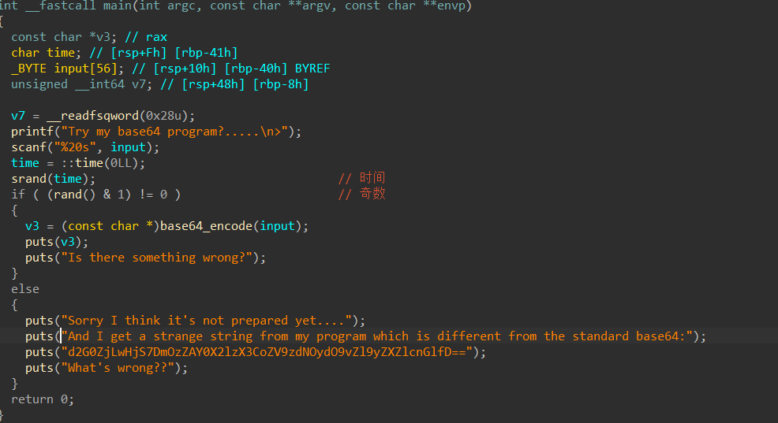
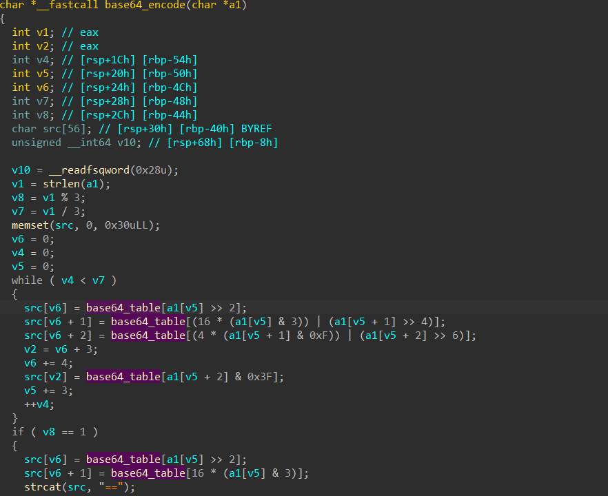
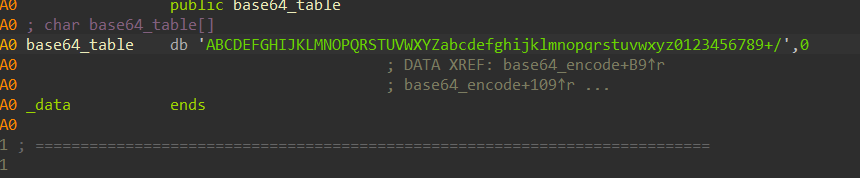
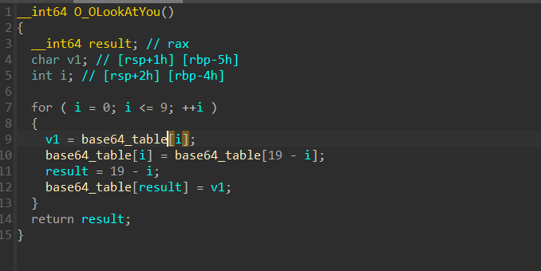
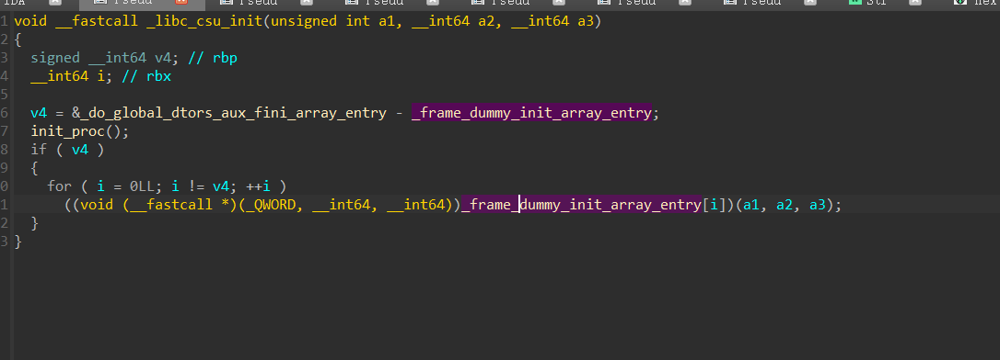
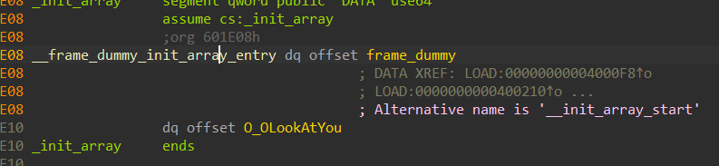
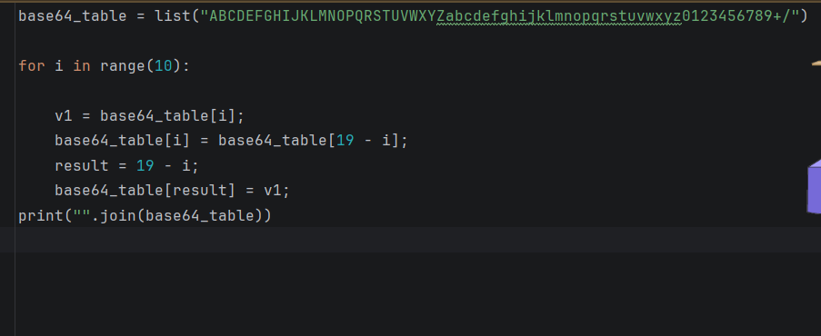
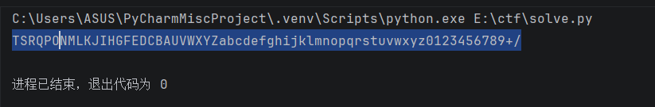
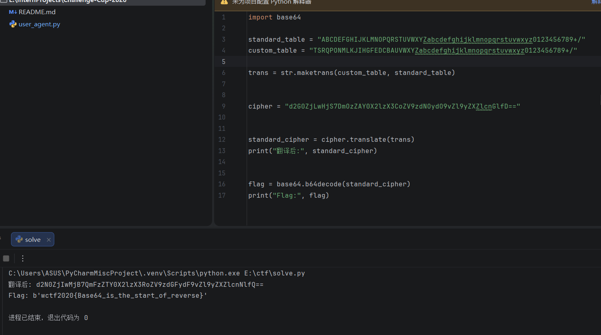

.ELF文件，没壳

放进ida能看见很多字符串：

点进去看之后

大概是如下：

我们输入内容，然后用时间当成种子生成随机数，奇数偶数两个分支，一个是用一下base64，没什么判断，没用，另一个是给我们一串字符串，我们检查这个base64是正常的

但是解出来是乱七八糟的不对，之后卡在这里了，偶然交叉引用base64表发现了这个函数

改变了表，然后我去看这个函数，他是在init函数调用的，我查到这个函数是初始化，在main之前

用改完的表来看：

