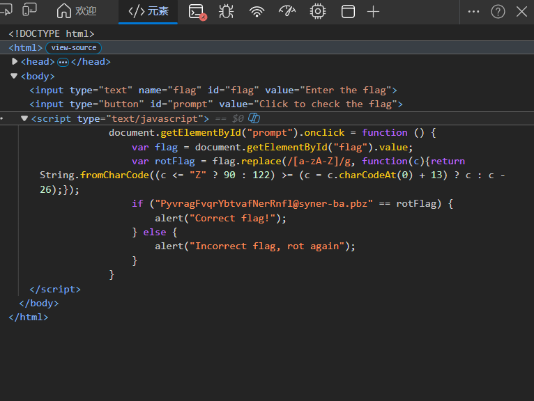

引擎文件点进去发现让我们输入内容并点击获得flag，摁F12，可以看到代码

可以看见下面判断过后有一个正确提示，向上追溯，是一个判断rotflag等于给出的字符串，而rotflag由flag变换得来，这个变换应该是如下逻辑：当前字符<Z则为90（Z）反之则为122（z）【换言之就是大写字母就是大写Z，小写字母则为z】，之后与后面的c+13之后的数值进行对比，如果是大于等于，则为其本身，如果不是则为其减去26，之后用这个数据与给出的字符串进行对比。而要想满足加上13之后要大于字母z/Z，就要找90-13=77（M），即，大于M/m的就变成c-26，小于等于则为其本身
