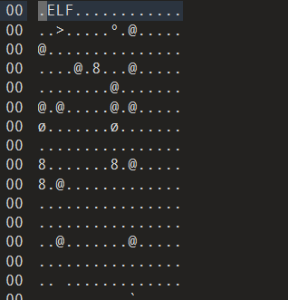

用010editor看一下文件类型，是linux系统的可执行文件



观察代码，发现这里有一个构造flag的函数，主要是把两个字符串拼接起来，f1已经得到是GXY{do_not_，f2是把s赋值给f2后再进行一个变换。

```
  s = 0x7F666F6067756369LL;
for ( j = 0; j <= 7; ++j )
        {
          if ( j % 2 == 1 )
            *(&f2 + j) -= 2;
          else
            --*(&f2 + j);
        }
```

进行变换之后得到的f2是hate_me}

```
flag{do_not_hate_me}
```
