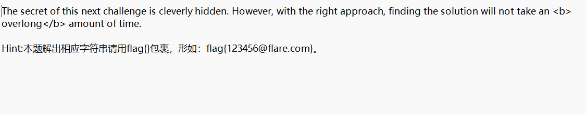
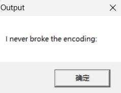
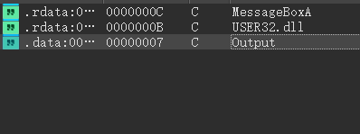
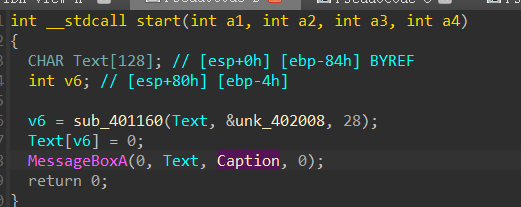
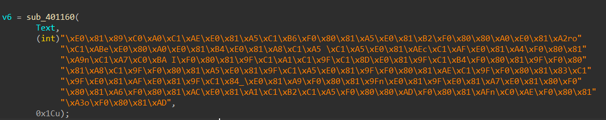
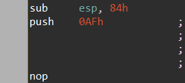
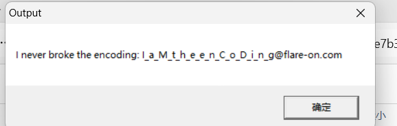

压缩包其中包括了一个txt，其中有部分提示：

运行exe之后弹出弹窗：

放进了ida里面之后查看字符串：

交叉引用output，会发现这样一个函数：

将解密后的文本显示在消息框中，消息框的标题是 "Output"，与我们看到的一致，

Text应该是文本框里面的内容，点进去看很长，摁a之后能看到：

这显然是对应题目overlong，不只是他解码出来的那个句子，因为 sub_401160 的第三个参数限制了只处理 28 字节，打个补丁：

