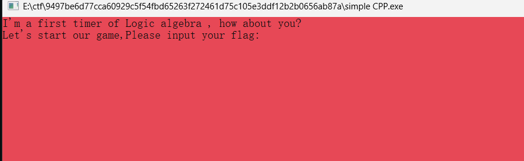

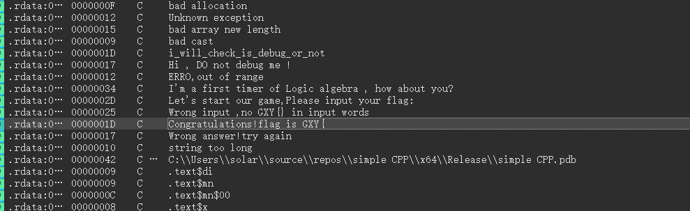

无壳，放进ida查string查到有成功的提示

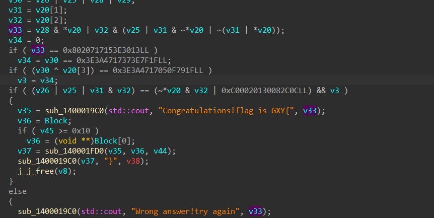

有点复杂，微吓哭，我先理一下：首先我们知道了输入，成功提示。从后往前看和从输出看都扯上了很多变量，给我看了很久也没明白到底想干什么，我打算动态调试看看，虽然后面有一个反调试

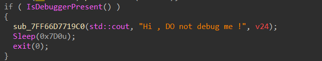

但是对前面的不影响，我就先看着。后面要有影响的时候打个补丁改掉就好了

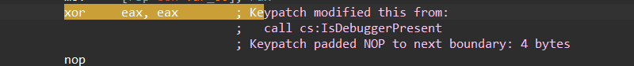

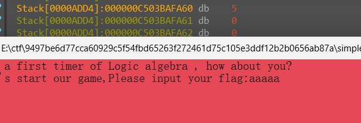

我后来在输出后面下断点，然后运行，输入了几次，我发现v44根据我输入的内容变化

如图，v44的数值就是我们输入的内容的长度，所以命名为length

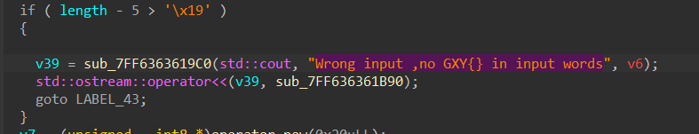

if ( length - 5 > '\x19' )这个比较，我非常好奇为什么特意要-5，问ai得知是利用了无符号，相当于length>=5并且还要满足<30,但是不知道哪这个作者到底咋想的，判断个长度竟然输出外壳不对，我当时难受半天也没看出来究竟哪里是判断了外壳对不对

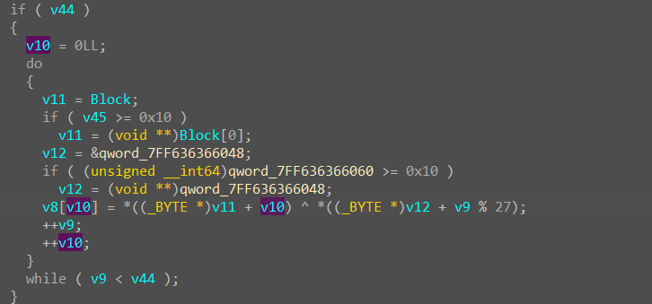

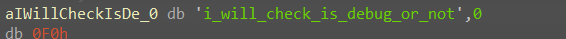

这段代码一开始静态的时候完全看不懂，但是在我动态调试之后，我发现v12有了值

而这段的意思差不多可以简化成下面这样

```
for (int i = 0; i < input.length(); ++i)
{
    v8[i] = input[i] ^ key[i % 27];
}
```

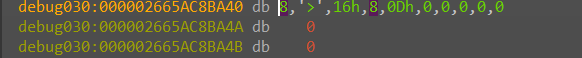

而v8的结果直接把断点下在后面，动态调试直接看就好，

然后后面是一个长度判断

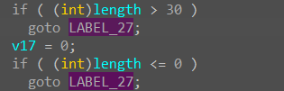

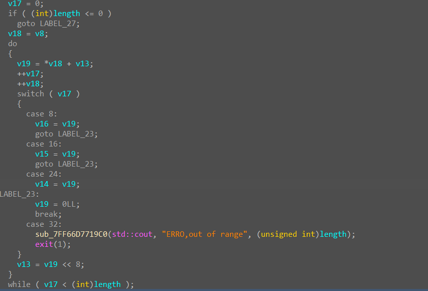

上面的这些代码，是对异或出来的内容分别储存在v14，v15，v16中，够8个之后赋值之后清空v19，然后再继续赋值。

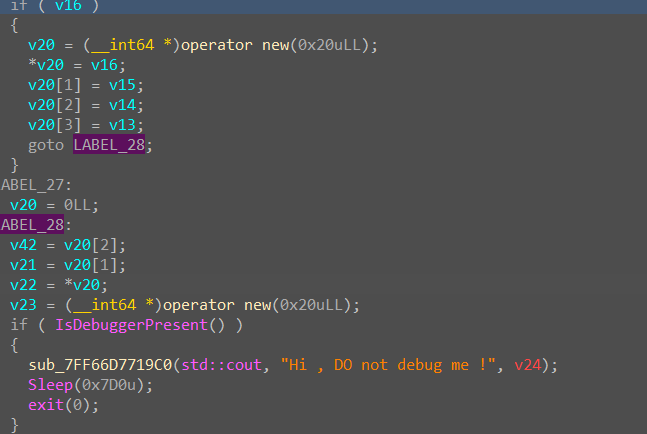

然后都赋值给v20。

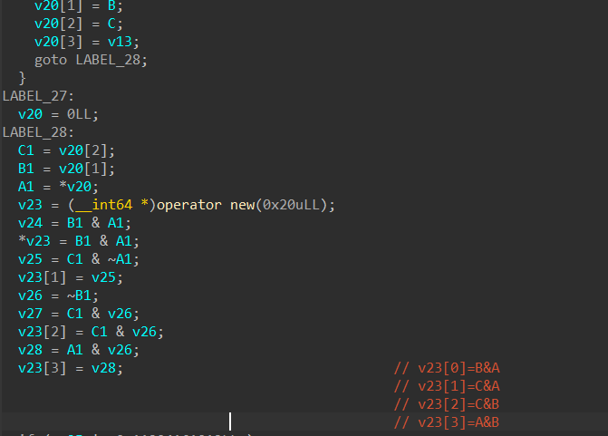

把v16，v15，v14改名成ABC，后面有一个&运算，大概如我图片中写的注释

后面是一些运算之后就进行了判断，跟字符串对比之后，正确则输入正确

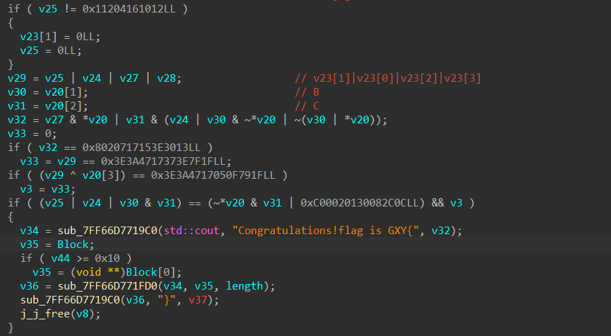

而求解大致就是：

→求 A/B/C/D

→ 把 A/B/C/D 拆回 XOR 后的字节

→ 再与密钥 XOR 一次，恢复输入

Z3我还不是很熟练打算这周再学一下

```python
from z3 import *

A, B, C, D = BitVecs("A B C D", 64)

X = A & B
Y0 = C & ~A
Y = If(Y0 == 0x11204161012, Y0, 0)
Z = C & ~B
W = A & ~B
T = Y | X | Z | W

U = (Z & A) | (C & (X | (B & ~A) | ~(B | A)))

s = Solver()
s.add(U == 0x08020717153E3013)
s.add(T == 0x3E3A4717373E7F1F)
s.add((T ^ D) == 0x3E3A4717050F791F)
s.add((Y | X | (B & C)) == ((~A & C) | 0x0C00020130082C0C))

if s.check() != sat:
    print("无解")
    quit()

m = s.model()
values = [m.eval(x).as_long() for x in (A, B, C, D)]

data = b"".join(x.to_bytes(8, "big") for x in values[:3])
data += values[3].to_bytes(8, "big")[4:7]

key = b"i_will_check_is_debug_or_no"
answer = bytes(x ^ y for x, y in zip(data, key))

print(answer)
print(b"GXY{" + answer + b"}")
```
