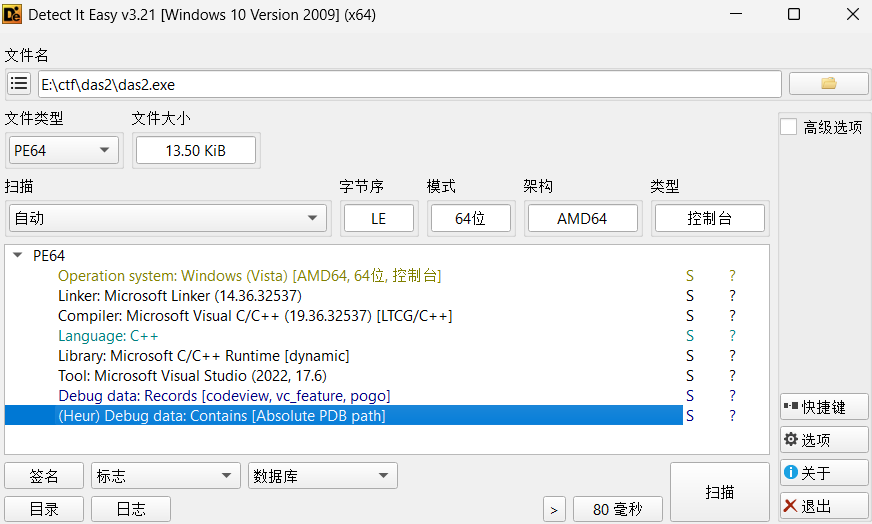
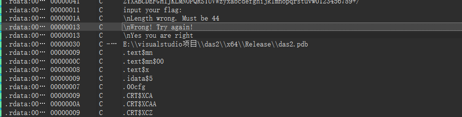
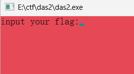
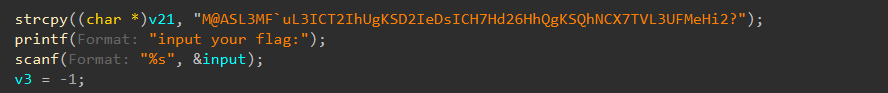
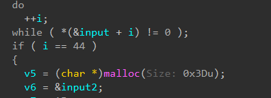
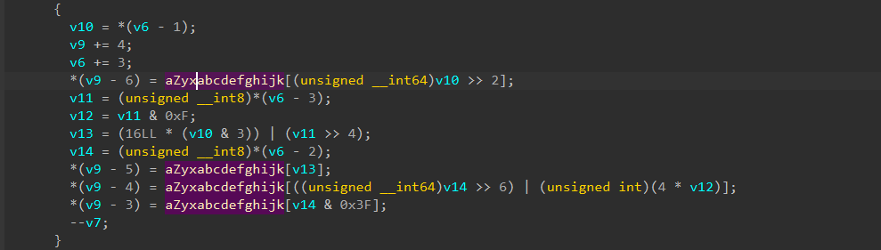
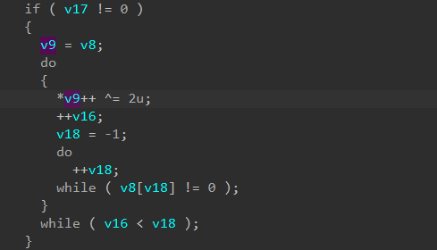
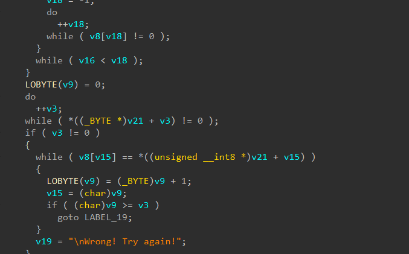

无壳，exe



字符串有正确错误的提醒，还有个表

运行让输入内容





跟踪进去之后有让输入的地方



循环之后的一个判断是i==44，我猜测是你输入的长度必须要满足44才能执行后续的内容

下面的循环里就用到了我们之前在字符串里面找到的表



里面的v10，v6什么的是用来给表的索引，然后[]里面的左移2我一开始不知道是什么用法，后来才明白是要把8位拆开成6位，而后面的也是，把两个字节的部分拼接起来，而*4在汇编里见过，他也就相当于一个左移，也是在拼接数字。

每次循环，v10、v11、v14 取到的正好是输入字符串中的 连续 3 个字节

v9 = v5+2 → v9+=4 变成 v5+6。写入 (v9-6) = v5[0]

所以我们可以发现每次循环正好连续写入 4 个字节刚好填满整个v5，这段是最猎奇的，看半天。

```
v8 = v5;并且v8[59] = 61;这个61就是=
```



这里呢就是在对v5进行异或，全都^2了

```
LOBYTE(v9) = 0;
```

这个东西我去查是去掉后面的两位换成了0。



这段判断总体就是让v8，也就是v5里面的东西和v21的哪个表相等，如果全都相等就弹正确

总体来汇总一下就是你输入44个，他给你按照他魔改的base64给你整出来之后和他的表进行对比，如果是对的就是正确。

```python
v21 = "M@ASL3MF`uL3ICT2IhUgKSD2IeDsICH7Hd26HhQgKSQhNCX7TVL3UFMeHi2?"
alphabet = "ZYXABCDEFGHIJKLMNOPQRSTUVWzyxabcdefghijklmnopqrstuvw0123456789+/"
base64_str = ''.join(chr(ord(c) ^ 2) for c in v21)
print("[*] 异或后的 Base64 字符串:", base64_str)
rev_table = {ch: idx for idx, ch in enumerate(alphabet)}
raw = bytearray()
i = 0
while i < len(base64_str):
    group = base64_str[i:i+4]
    # 过滤掉 '='
    valid = [ch for ch in group if ch != '=']
    # 如果没有有效字符，跳出
    if not valid:
        break
    # 查表得到索引
    idx = [rev_table[ch] for ch in valid]
    if len(valid) == 4:
        b1 = (idx[0] << 2) | (idx[1] >> 4)
        b2 = ((idx[1] & 0xF) << 4) | (idx[2] >> 2)
        b3 = ((idx[2] & 0x3) << 6) | idx[3]
        raw.extend([b1, b2, b3])
    elif len(valid) == 3:
        b1 = (idx[0] << 2) | (idx[1] >> 4)
        b2 = ((idx[1] & 0xF) << 4) | (idx[2] >> 2)
        raw.extend([b1, b2])
    elif len(valid) == 2:
        b1 = (idx[0] << 2) | (idx[1] >> 4)
        raw.extend([b1])
    else:
        pass
    i += 4
flag_bytes = raw[:-1]
try:
    flag = flag_bytes.decode('ascii')
    print("[+] 你的 Flag 是:", flag)
except UnicodeDecodeError:
    print("[-] 解码失败，可能有其他问题。")
    print("原始字节:", flag_bytes.hex())
```
