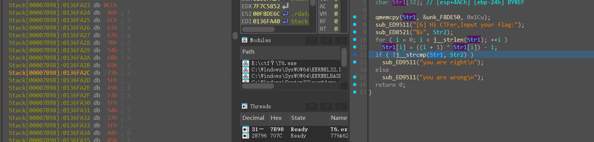

```cpp
int __cdecl main_0(int argc, const char argv, const char envp)
{
  size_t i; // [esp+190h] [ebp-340h]
  char input[264]; // [esp+3A4h] [ebp-12Ch] BYREF
  char str[32]; // [esp+4ACh] [ebp-24h] BYREF

  qmemcpy(str, &aGoNzIxrbxrfojE, 0x1Cu);
  printf("[6] Hi CTFer,Input your flag:");
  scanf("%s", input);
  for ( i = 0; i < j__strlen(str); ++i )
    str[i] = ((i + 1) ^ str[i]) - i;
  if ( !j__strcmp(str, input) )
    printf("you are right\n");
  else
    printf("you are wrong\n");
  return 0;
}
```

我们输入一个字符串，然后与str做了一些变换之后的字符串进行对比，得到正确或错误，所以flag就是得到str进行了变换之后的字符串是什么

我们找到str：'Go`nz_ixrbXRfoJ~EDG|NbL@rh'

而他经过了如下变换：

```
for ( i = 0; i < j__strlen(str); ++i )
    str[i] = ((i + 1) ^ str[i]) - i;
```

他让每一位的str都和i+1进行了一次异或之后再加i

我们可以通过写脚本来把他倒回去

但是动态调试更快



```
Flag{This_IS_T7_DEBUG_EASY}
```
