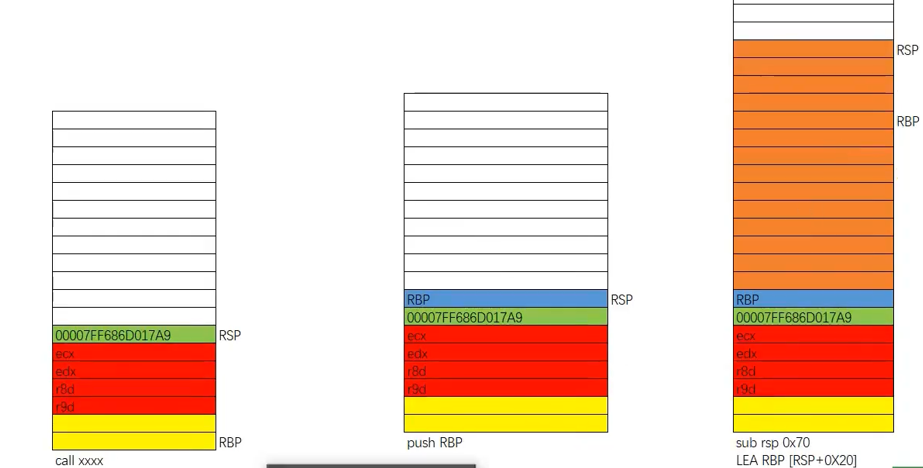

之前讲解了x86架构的，今天来说说x64的函数调用约定~

与x86不同，x64在调用之前用`mov`来把参数传给寄存器（前四个是传给寄存器，分别是`rcx`，`rdx`，`r8`，`r9`，
后面的`mov`进栈）之后再`call`，进入`call`之后，再`mov`把寄存器里的参数传进栈中，再`push rbp`保存旧的`rbp`，然后`sub`提升栈顶，
这里又有所不同，x86是`mov ebp，esp`，然后`ebp`就呆在原本保存旧`ebp`的地方，
x64不同，它通过`lea`传给`rbp`一个`esp+0xn`的地址，地址与`rsp`之间的空间，正是留给参数，
留作该函数后续再调用其他函数时，`mov`参数所用而`rbp`也不在原本保存旧的`rbp`的地方了，就不能说`rbp+4`是参数了~

~~感觉和x86比起来不是很喜欢x64呢~~

