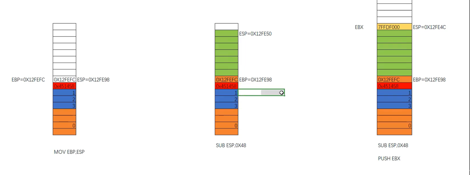
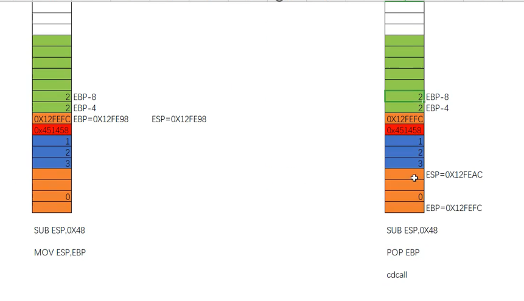

在这里我分享x86架构下栈帧调用的细节与流程~

调用时，先存入参数，再`call`->先存下一步的地址

再`push ebp` 存入EBP原来的位置之后`mov ebp, esp`->提升栈底到栈顶位置



然后再`sub`一下开辟空间，然后`push`保存寄存器->解放他们方便用来计算

然后给局部参数（是ebp-0x4这样开始给）



然后结束之后，还原，`mov esp,ebp`，把`esp`拉下来，原本开辟的空间不要了，
这个时候刚刚好，欸，到了这个存放`ebp`这个地方，
再`pop ebp`还给它。然后到了那个红色的，存放下一条指令的地方，
`pop`之后呢，下面的参数直接进行一个`ADD`，把`ESP`给还原掉，参数顺道也不要了

（这一步取决于调用约定如果是 cdecl 就是调用者 `add esp, X`；
如果是 stdcall，则是被调用者在 `ret` 时直接 `ret X`顺便平栈）

最后形成的大概如下~

```text
高地址
... 
[ebp + 0xC]  <-- arg2
[ebp + 0x8]  <-- arg1   （为什么+8？因为跨越了返回地址和旧ebp）
[ebp + 0x4]  <-- 返回地址 (Return Address)
[ebp]        <-- main函数的旧 ebp （当前的地基）
[ebp - 0x4]  <-- 局部变量1
[ebp - 0x8]  <-- 局部变量2
...
[ebp - 0x64] <-- 局部变量100
[esp]        <-- 当前栈顶
```
我们可以通过`ebp+0x8`找到对应的参数~