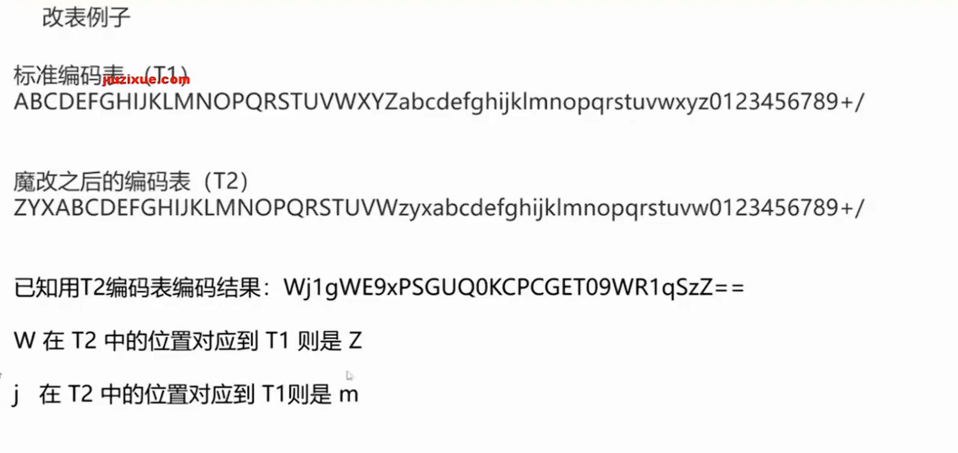
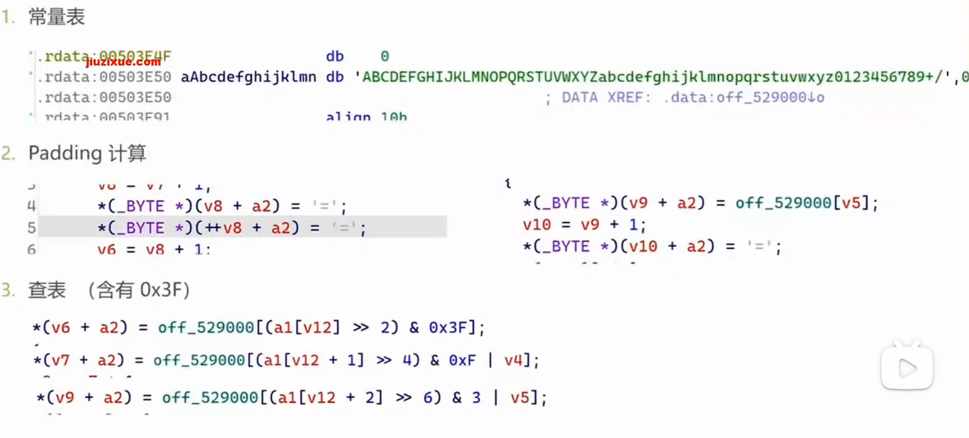

在这里分享最基础的base64题目处理~

Base64是一种把二进制数据编码成文本的编码风格，它使用64个字符编码数据
一个字节有256种不同的数据（8bit，而一个base64字符有64种数据（6bit
就相当于把256位的东西转换成64进制的东西，可以把它想象成一个进制转换

4位base64可以表示3个字节（一个base64字符只能表示64种情况，要表示256种情况就要更大的空间，不足的用=补齐）

常见变形：1.修改编码表，2.修改下标
1：比如把原本0对应的A改成Q，但是不管怎么改，index没变
所以只需要反推index，再去标准表里找到对应的值是多少就行，写出标准表对应的字符串之后再用标准表的解码函数进行解码

例子：



2：把base64的编码查表下标对应关系修改，对于这种修改，我们只需要推到出下标逆运算即可
识别：



一，找字符串 二，看等号 三，看0x3F

脚本：
最常用：

`import base64`

# 编码：字符串 → Base64

`text = "#待输入"
encoded = base64.b64encode(text.encode()).decode()
print(f"编码: {text} → {encoded}")  # aGVsbG8=`

# 解码：Base64 → 字符串

`decoded = base64.b64decode(encoded).decode()
print(f"解码: {encoded} → {decoded}")  # hello`
在ida里查找base64：

```python

standard = "ABCDEFGHIJKLMNOPQRSTUVWXYZabcdefghijklmnopqrstuvwxyz0123456789+/"

for s in strings():
    text = s.string
    if "ABCDEFGHIJKLMNOPQRSTUVWXYZ" in text and len(text) >= 64:
        print(f"可能的码表 @ {hex(s.ea)}: {text[:70]}...")

```

我常常苦恼几个概念，encode，decode，string（字符），byte（字节）这里碎碎念一点点~

```text

字符 'A'
  │  字符编码：给字符编号
  ▼
编号 65              ← 这就是 ASCII 码 / Unicode 码点
  │  数字写法：同一个数可以写成十进制或十六进制
  ▼
65 也可写成 0x41     ← 16 进制只是“写法”，不是字符，也不是字节
  │  encode：按 UTF-8 把字符变成字节
  ▼
字节 0x41            ← 1 个字节，值是 65

```

```text
字符 '中'
  │  Unicode 编号
  ▼
编号 20013（十六进制写法 0x4E2D）
  │  UTF-8 编码
  ▼
字节 E4 B8 AD        ← 3 个字节

```