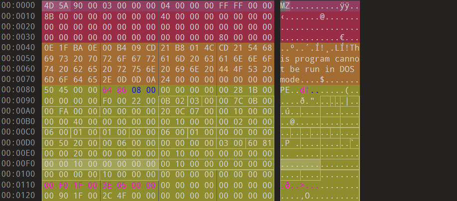
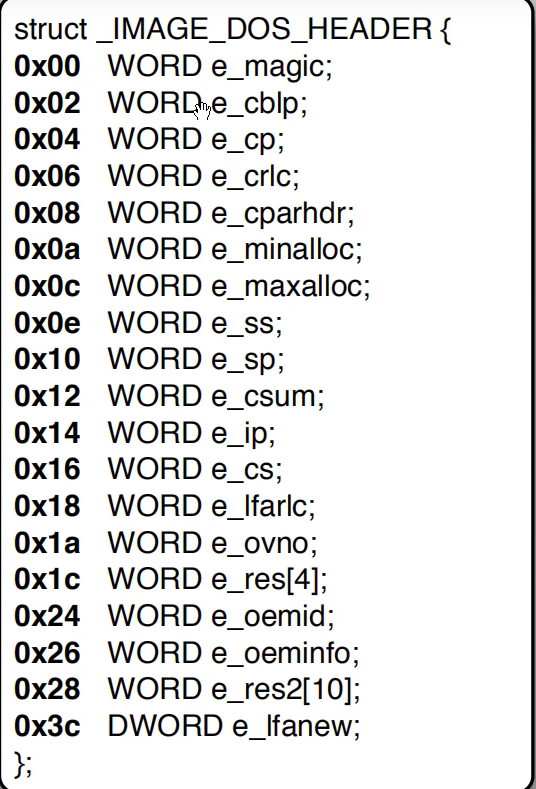

这里分享PE文件解析！首先是DOS头~



DOS头我们主要注意两个字段！刚好就是第一个和最后一个



## 1.e_magic字段

e_magic字段是两个字节，**小端序存储！**我们一看到`0x5A4D`，也就是MZ，就知道，他是一个PE文件，这正是他的标志。

## 2.e_lfanew字段

e_lfanew字段指示着PE头的位置，e_lfanew 字段存放的是一个偏移量，它指向 PE 签名（PE\0\0）在文件中的具体位置，010editor完美的展示了PE头所在位置，我们当场验证一下吧！小端序，所以是0x80，刚好就是PE头位置所在。

下面是一段代码

```c
#include<Windows.h>
#include<iostream>

int main()
{
	HANDLE hfile = CreateFileA("", GENERIC_READ, FILE_SHARE_READ, NULL, OPEN_EXISTING, FILE_ATTRIBUTE_NORMAL, 0);//填入你要观察的PE文件！
	if (hfile == INVALID_HANDLE_VALUE) {
		printf("打开文件失败！错误码：%d\n", GetLastError());
		system("pause"); 
		return 0;
	}
	DWORD filesize = GetFileSize(hfile, NULL);

	
	printf("成功打开文件，大小: %lu 字节\n", filesize);

	char* fileBuff = new char[filesize];
	DWORD realREAD = 0;
	BOOL bsucess = FALSE;
	bsucess = ReadFile(hfile, fileBuff, filesize, &realREAD, NULL);
	if (bsucess)
	{
		PIMAGE_DOS_HEADER pDosheaders = (PIMAGE_DOS_HEADER)fileBuff;
		if (pDosheaders->e_magic != 0x5A4D)
		{
			printf("不是有效的PE文件\n");
			delete[] fileBuff;
			CloseHandle(hfile);
			system("pause");
			return 0;
		}

		printf("这是一个标准的 PE 文件\n");
	}
	else {
		printf("ReadFile 读取失败！错误码：%d\n", GetLastError());
	}


	delete[] fileBuff;
	CloseHandle(hfile);

	system("pause");
	return 0;
}
```

这段代码检查DOS头来判断是否是一个PE文件，所依靠的，就是检查e_magic字段